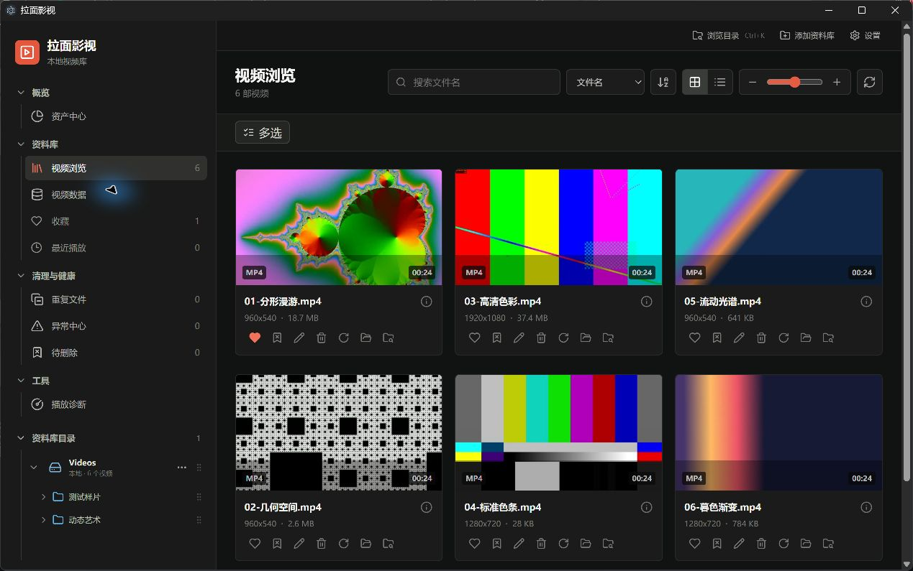
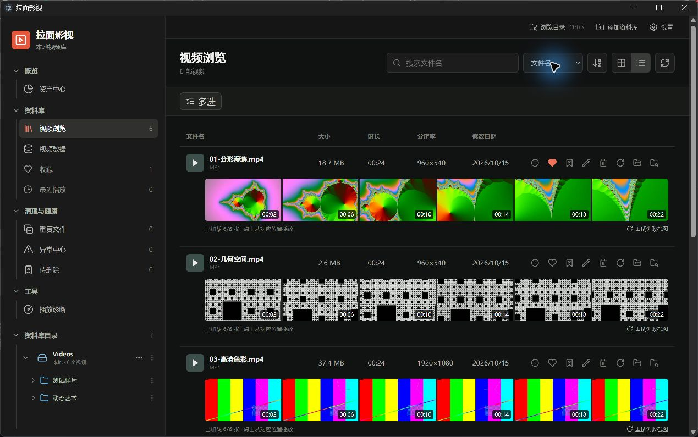
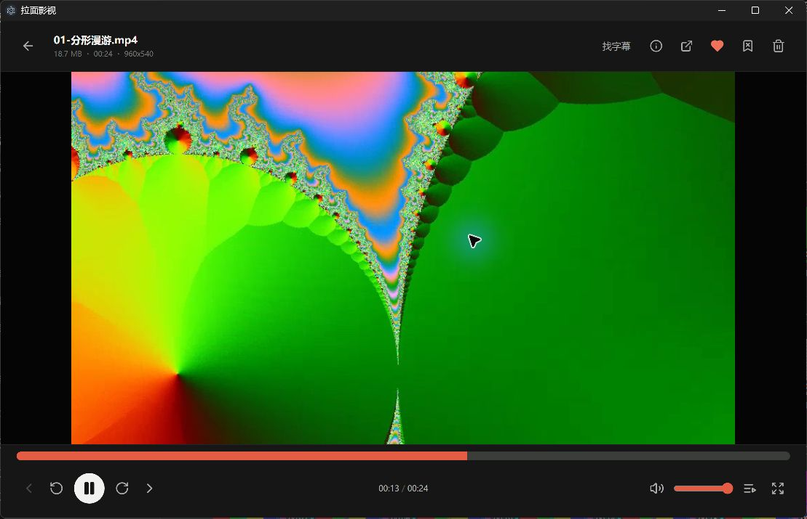
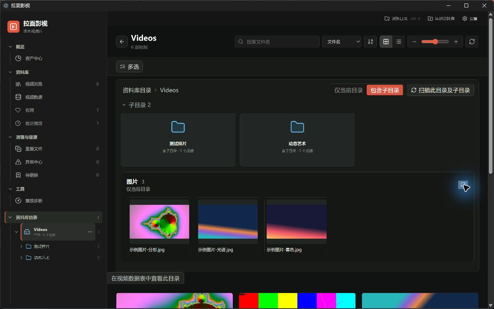
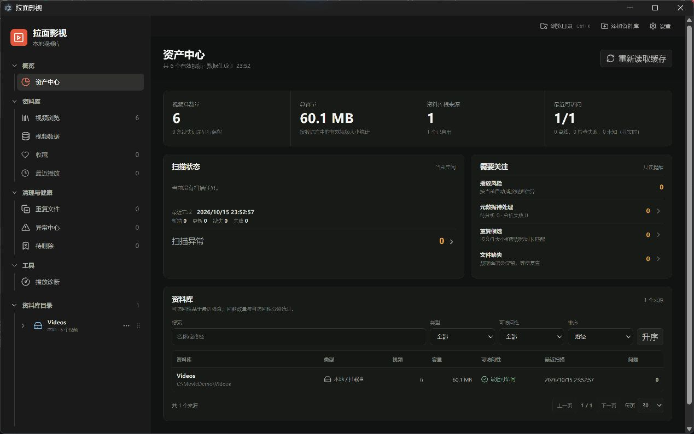
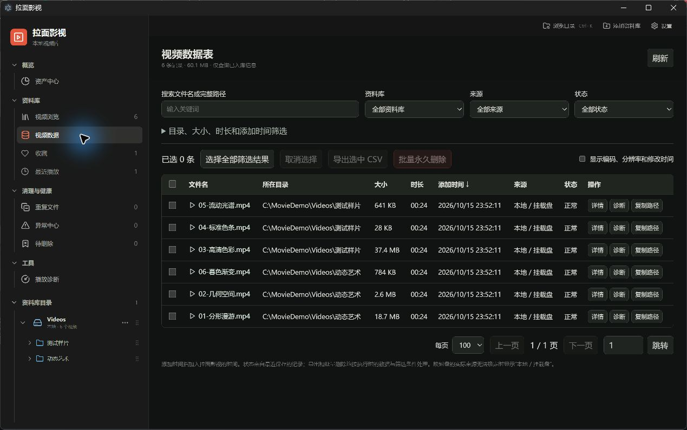

# 拉面影视 · Movie

免费的 Windows 本地视频管理工具：把硬盘、NAS 和挂载网盘里的视频整理成可搜索、可预览、可播放的资料库，视频保留在原位置。项目早期名称为“映匣”。

**当前正式版：v0.1.17 Latest（界面版本 v1.43）** · **[Windows x64 绿色版下载](https://github.com/huntian0727/movie/releases/tag/v0.1.17)** · [正式发行说明](docs/releases/0.1.17.md) · [完整使用教程](docs/user-guide/0.1.17.md) · [界面预览](#界面预览) · [快速开始](#下载与第一次使用) · [更新记录](CHANGELOG.md) · [问题反馈](https://github.com/huntian0727/movie/issues)

> v0.1.17 于 2026-10-26 正式发布并标记为 Latest。技术包版本为 **0.1.17**，程序左上角显示的界面版本为 **v1.43**，两者用途不同。

## 下载与第一次使用

1. 打开 [v0.1.17 正式发行页](https://github.com/huntian0727/movie/releases/tag/v0.1.17)，下载 **[Movie-0.1.17-Windows-x64-Portable.zip](https://github.com/huntian0727/movie/releases/download/v0.1.17/Movie-0.1.17-Windows-x64-Portable.zip)** 和 `SHA256SUMS.txt`。
2. 按[文件校验说明](docs/windows-installation.md)核对 ZIP 的 SHA-256；校验不符时停止使用。
3. 将 ZIP **完整解压**到自己的程序文件夹，例如 `D:\Apps\Movie-0.1.17`。
4. 双击 **`拉面影视-免费分享版.exe`**。无需安装 Node.js、npm 或单独安装 FFmpeg；播放器运行库已随包提供。
5. 点击右上角 **添加资料库 → 添加本地或挂载目录**，先选择一个小视频文件夹。扫描完成后进入 **视频浏览**，点击封面播放，并试用搜索、收藏和最近播放。

当前正式下载为 Windows x64 **免安装绿色 ZIP**，没有 NSIS 安装器，程序也未做代码签名。不要下载 GitHub 自动生成的 `Source code` ZIP 当作程序，不要直接在压缩软件内运行 EXE，也不需要关闭系统防护来绕过安全提示。

目标平台为 Windows 11 x64。本版使用维护者选择的 Windows 11 Insider Preview 沙盒证据；没有声称已覆盖所有稳定版 Windows、标准用户权限、4K/HDR、长时间压力及真实 CloudDrive/115 永久删除场景。完整范围见[正式发行说明](docs/releases/0.1.17.md)。

## 可以做什么

| 场景 | 功能 |
| --- | --- |
| 整理视频 | 添加目录、递归扫描、文件名搜索、网格/列表、排序和分页 |
| 浏览目录 | 来源总览、目录树、子目录浏览、图片缩略图和大图查看 |
| 日常观看 | 独立播放窗口、进度跳转、音量、全屏、播放列表、收藏、最近播放和字幕搜索 |
| 播放倍速 | 支持 0.5×–5×，包含 3×、4×、5× 高倍速；切换视频时保留倍速选择 |
| 待分析处理 | 可选开启“本页自动分析”（默认关闭）；CloudDrive 暂缓分析与真实失败分开显示 |
| 异常管理 | 按扫描失败、文件缺失、元数据分析失败等原因分类，并与正常后台任务分开 |
| 清理重复 | 按文件大小和四舍五入到整秒的时长筛选候选；按组确认保留项、待清理项和预计回收空间 |
| 后台清理 | 清理任务进入 FIFO 后台队列；可继续浏览和播放，已受理项目暂时隐藏，未知结果不自动重试 |
| 数据管理 | 查看及安全迁移资料库数据目录，并查看离线维护说明 |
| 挂载网盘 | 把 CloudDrive 等挂载盘作为普通目录添加；CloudDrive API 可用于选择远端目录和元数据扫描 |

**关于重复文件清理：**程序只比较精确文件大小和四舍五入到整秒的视频时长，不计算内容哈希；相同大小和时长不保证内容相同。执行前仍会复查路径、大小、修改时间和文件身份，请认真核对保留项。应用内的永久删除会实际删除源文件，且**不进入 Windows 回收站**。

## 界面预览

以下为 **v0.1.15 正式绿色版的真实界面截图**，使用独立示例资料库与自制合成视频、图片。截图尚未更新为 v0.1.16 的新界面；它们仅展示已有界面与基础操作，不代表所有新版控件。点击图片可查看大图，示例文件不随程序提供。

### 封面浏览：一眼找到想看的视频

以网格查看封面、文件名、时长、分辨率和大小，支持搜索、排序、调整卡片大小与收藏。左侧目录树可以快速缩小浏览范围。

### 时间轴预览：先看内容，再决定播放

列表模式按时间点展示多张截图，不必逐个打开视频。点击某张截图，就能从对应位置开始播放。

### 独立播放器：浏览与观看各有空间

视频在独立窗口中播放，提供进度跳转、快进快退、音量、全屏、播放列表与收藏操作，也有字幕查找入口。画面中的分形动画为自制测试样片。

### 目录浏览：沿用自己的文件夹结构

通过目录树、面包屑和子目录卡片逐层查看，可切换“仅当前目录”或“包含子目录”。同目录的图片也能直接预览、点击查看大图。

### 资产中心：了解资料库的整体情况

集中查看视频数量、总容量、来源、最近扫描与可访问状态，并从元数据待处理、重复候选、文件缺失等提醒进入相应页面。

### 视频数据表：筛选、核对与导出

按资料库、来源、状态、目录、大小、时长等条件查询已入库信息，查看文件所在目录，并将选中的记录导出为 CSV。

## 按需求阅读

- [v0.1.17 正式发行说明](docs/releases/0.1.17.md)：本版安全、性能、功能变化和未覆盖的验收范围。
- [v0.1.17 完整使用教程](docs/user-guide/0.1.17.md)：添加方式、115 / CloudDrive API 配置、播放、字幕、备份、升级和常见问题。
- [快速开始](docs/QUICK_START.md)：从下载、校验到首次扫描的简要步骤。
- [滚动使用教程](docs/USER_GUIDE.md)：维护中的说明，部分段落会标注尚未进入公开版的本地开发功能；普通用户以正式发行说明和固定版本教程为准。
- [免安装版与数据目录](docs/portable.md)：程序目录与资料库的区别、移动程序及升级。
- [CloudDrive 配置与排错](docs/clouddrive2-acceleration.md)：同机 API、HTTPS、挂载路径和“待分析”。

## 数据与文件操作

公开免费分享版的数据目录为 **`%APPDATA%\local-video-manager-community`**，包含 `library.sqlite`、设置、日志及缓存；程序文件夹不包含全部个人数据。开发版和隔离测试版使用不同数据目录，详见[身份对照表](docs/portable.md)。

- 添加目录建立索引；“从资料库移除”移除索引；清理缓存删除可重建预览。这些操作不会因此删除源视频。
- 应用内的移动、重命名和**永久删除**会实际操作源文件；永久删除不进入 Windows 回收站。重复候选只按大小与整秒时长识别，不计算内容哈希。
- 退出后备份整个对应数据目录，原视频另做备份。不同发行身份不自动合并；换电脑或 Windows 用户后，受保护凭据可能需要重新输入。

CloudDrive 与在线字幕是可选联网功能。字幕查询可能发送文件名、关键词或语言等信息；不要公开 Token，诊断资料分享前先审阅。

## 更新与反馈

退出旧程序，将同一发行身份的新版完整解压到新文件夹，核对数据后再移除旧程序目录。当前没有承诺应用内自动更新。[详细升级步骤](docs/portable.md)。

普通问题请附应用版本、Windows 版本、来源类型、复现步骤与脱敏错误信息，提交到 [GitHub Issues](https://github.com/huntian0727/movie/issues)。不要上传 Token、整份数据库或私人视频；安全漏洞按 [SECURITY.md](SECURITY.md) 私人报告。

## 开发与发布

维护流程为：**日常开发版持续使用 → 维护者要求发版 → 隔离绿色候选包 → 本机与沙盒验收 → GitHub Release**。源码同步与公开下载包发布分开执行。[开发、测试和文档更新约定](docs/DEVELOPMENT_AND_RELEASE.md) · [极简绿色 ZIP 发布 SOP](docs/RELEASE_FASTPATH.md)。

工具链固定 Node.js 22.23.1 / npm 10.9.8，使用 Electron、React、TypeScript、Vite 和 SQLite。[开发接手入口](docs/ai/START_HERE.md) · [原生模块工作流](docs/native-abi-workflow.md) · [源码绿色版发布流程](docs/SOURCE_COMMUNITY_RELEASE.md) · [发布清单](docs/RELEASE_CHECKLIST.md)。

## 许可

项目自有代码与文档使用 [MIT License](LICENSE)，免费开源。Electron、FFmpeg、libmpv 等组件保留各自适用许可；同一 Release 提供对应源码及来源说明，包内声明位于 `resources/legal`。[第三方声明](THIRD_PARTY_LICENSES.md) · [验证范围](docs/releases/0.1.17.md)。

早期静态 Lite、安装器和首次发布审计资料保留用于溯源，不代表当前公开 ZIP 未发布或已覆盖所有环境；历史批准不能自动批准新版本。
