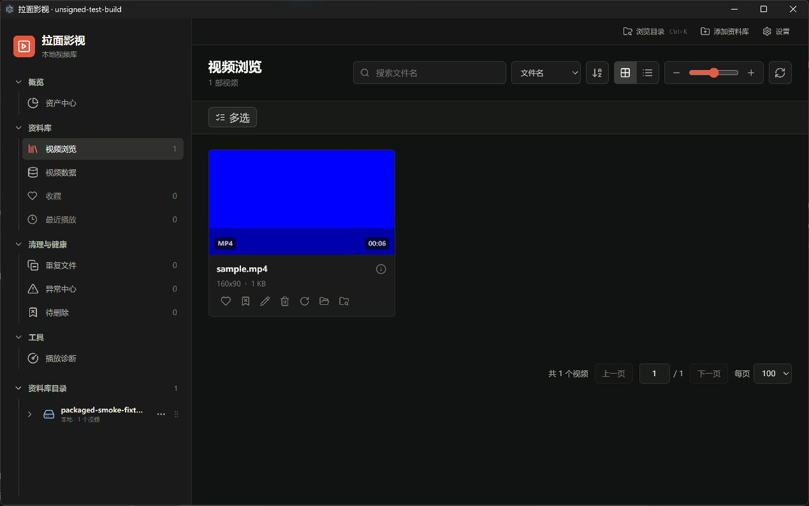

# 拉面影视 · Movie

免费的 Windows 本地视频管理工具：把硬盘、NAS 和挂载网盘里的视频整理成可搜索、可预览、可播放的资料库，视频保留在原位置。项目早期名称为“映匣”。

**[下载正式绿色版 0.1.15](https://github.com/huntian0727/movie/releases/tag/v0.1.15)** · **[完整使用教程](docs/user-guide/0.1.15.md)** · [快速开始](docs/QUICK_START.md) · [更新记录](CHANGELOG.md) · [问题反馈](https://github.com/huntian0727/movie/issues)

## 下载与第一次使用

1. 在 [Release 下载页](https://github.com/huntian0727/movie/releases/tag/v0.1.15) 选择 **`Movie-0.1.15-Windows-x64-Portable.zip`**，同时下载 `SHA256SUMS.txt`。
2. [核对文件](docs/windows-installation.md)后，把 ZIP **完整解压**到自己的程序文件夹。
3. 双击 **`拉面影视-免费分享版.exe`**。无需安装 Node.js、npm 或单独安装 FFmpeg；播放器运行库已随包提供。
4. 点击右上角 **添加资料库 → 添加本地或挂载目录**，先选择一个小视频文件夹。
5. 扫描后进入 **视频浏览**，点击封面播放；试一下搜索、收藏，退出后再打开确认记录保留。

当前公开下载为 Windows x64 **免安装 ZIP**，没有本轮正式安装器。不要下载 `Source code` ZIP 当作程序，也不要直接在压缩软件里运行 EXE。程序未做代码签名，系统可能提示未知发布者；来源或校验不符时停止使用，不需要关闭系统防护。

目标平台是 Windows 11 x64。本次正式验收使用维护者选择的 Windows 11 Insider Preview 沙盒；其他硬件、系统、普通标准用户、4K/HDR 和长时间压力等覆盖情况见 [发行说明](docs/releases/0.1.15.md)。

## 可以做什么

| 场景 | 功能 |
| --- | --- |
| 整理视频 | 添加目录、递归扫描、文件名搜索、网格/列表、排序和分页 |
| 浏览目录 | 来源总览、目录树、子目录浏览、图片缩略图和大图查看 |
| 日常观看 | 独立播放窗口、进度跳转、音量、收藏、最近播放和字幕搜索 |
| 挂载网盘 | 把 CloudDrive 等挂载盘作为普通目录添加 |
| CloudDrive API | 选择远端目录、保存远端身份、元数据扫描；预览和播放仍需挂载路径 |
| 检查资料库 | 扫描异常、缺失文件、元数据状态、视频数据查询和选中记录 CSV 导出 |
| 清理重复 | 查看候选，完整 SHA-256 验证后再明确确认永久删除 |

截图来自合成视频与隔离资料库，界面细节以对应版本为准：

## 按需求阅读

- [0.1.15 完整教程](docs/user-guide/0.1.15.md)：添加方式比较、115 / API 配置、播放、字幕、快捷键、备份、升级和常见问题。
- [最新开发状态教程](docs/USER_GUIDE.md)：包含尚未进入公开下载包的功能标记；`main` 的代码更新不等于已经发布新程序。
- [免安装版与数据目录](docs/portable.md)：程序目录与资料库的区别、移动程序及升级。
- [CloudDrive 配置与排错](docs/clouddrive2-acceleration.md)：同机 API、HTTPS、挂载路径和“待分析”。

## 数据与文件操作

公开免费分享版的数据目录为 **`%APPDATA%\local-video-manager-community`**，包含 `library.sqlite`、设置、日志及缓存；程序文件夹不包含全部个人数据。开发版和隔离测试版使用不同数据目录，详见 [身份对照表](docs/portable.md)。

- 添加目录建立索引；“从资料库移除”移除索引；清理缓存删除可重建预览。这些操作不会因此删除源视频。
- 应用内的移动、重命名和**永久删除**会实际操作源文件；永久删除不进入 Windows 回收站。重复候选的大小、时长相同不等于内容相同，须按界面完整哈希验证和 `DELETE` 二次确认。
- 退出后备份整个对应数据目录，原视频另做备份。不同身份不自动合并；换电脑或 Windows 用户后，受保护凭据可能需要重新输入。

CloudDrive 与在线字幕是可选联网功能。字幕查询可能发送文件名、关键词或语言等信息；不要公开 Token，诊断资料分享前先审阅。

## 更新与反馈

退出旧程序，将同一发行身份的新版完整解压到新文件夹，核对数据后再移除旧程序目录。当前没有承诺应用内自动更新。[详细升级步骤](docs/portable.md)。

普通问题请附应用版本、Windows 版本、来源类型、复现步骤与脱敏错误信息，提交到 [GitHub Issues](https://github.com/huntian0727/movie/issues)。不要上传 Token、整份数据库或私人视频；安全漏洞按 [SECURITY.md](SECURITY.md) 私人报告。

## 开发与发布

维护流程为：**日常开发版持续使用 → 维护者要求发版 → 隔离绿色候选包 → 本机与沙盒验收 → GitHub Release**。源码同步与公开下载包发布分开执行。[开发、测试和文档更新约定](docs/DEVELOPMENT_AND_RELEASE.md)。

工具链固定 Node.js 22.23.1 / npm 10.9.8，使用 Electron、React、TypeScript、Vite 和 SQLite。[开发接手入口](docs/ai/START_HERE.md) · [原生模块工作流](docs/native-abi-workflow.md) · [源码绿色版发布流程](docs/SOURCE_COMMUNITY_RELEASE.md) · [发布清单](docs/RELEASE_CHECKLIST.md)。

## 许可

项目自有代码与文档使用 [MIT License](LICENSE)，免费开源。Electron、FFmpeg、libmpv 等组件保留各自适用许可；同一 Release 提供对应源码及来源说明，包内声明位于 `resources/legal`。[第三方声明](THIRD_PARTY_LICENSES.md) · [验证范围](docs/releases/0.1.15.md)。

早期静态 Lite、安装器和首次发布审计资料保留用于溯源，不代表当前公开 ZIP 未发布或已覆盖所有环境；历史批准不能自动批准新版本。
